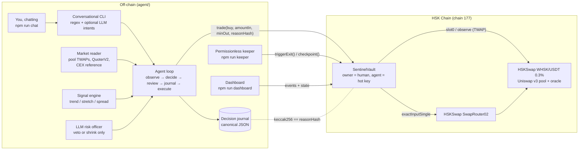

# 🛡️ HSK Sentinel

**An AI trading agent for HSKSwap that cannot blow up your wallet. The agent decides, and a smart contract on HSK Chain enforces the limits.**

Built for the [HSK Chain Horizon Hackathon · Seoul](https://dorahacks.io/hackathon/hskchainseoul/detail), **Track 1: AI Agent Trading**.

> Autonomous trading agents fail in two ways: the strategy is wrong, or the agent itself goes wrong (a hallucinated size, `minOut = 0`, a leaked hot key, a crashed server during a crash). Most agents only address the first. Sentinel addresses the second **on-chain**: the agent's key can only trade inside a policy the owner signs, every exit is enforceable by anyone, and every decision is committed on-chain as a hash.

---

## What it does

| Track requirement | How Sentinel does it |
|---|---|
| Monitor markets, analyze on-chain data | Reads the HSKSwap WHSK/USDT pool oracle directly: spot + 1m/5m/15m/1h TWAPs from `observe()`, executable quotes from HSKSwap QuoterV2 |
| Identify signals, execute autonomously | Deterministic signal engine (trend = 5m vs 1h TWAP, stretch = spot vs 15m TWAP), autonomous loop, on-chain execution through `SentinelVault.trade()` |
| Spot arbitrage and spread opportunities | Compares the DEX price against an off-chain CEX reference (CoinGecko); trades only when the spread clears the 0.30% pool fee plus a risk-dependent edge |
| Strict risk controls and stop-loss rules | **Enforced by the contract, not the bot:** per-trade and daily caps, cooldown, TWAP-anchored slippage floor, spot/TWAP manipulation guard, max exposure, drawdown circuit breaker, stop-loss and take-profit that **anyone** can trigger |
| Conversational interface: positions, PnL, size, frequency, risk, assets | `npm run chat`: "how am I doing?", "trade 40 USDT max", "be more conservative", "check every 5 minutes", "what can you trade?", "stop 3%", "show trades". An optional LLM handles free-form phrasing |
| AI decision-making | Optional LLM "risk officer" reviews each proposed trade and may **veto or shrink it, never enlarge it**. The full reasoning is journaled and its keccak256 is written on-chain with the trade |

## Architecture



### Who can do what

| Action | Owner (cold wallet) | Agent (hot key) | Anyone (keeper) |
|---|---|---|---|
| Deposit / withdraw funds | ✅ | ❌ | ❌ |
| Set policy, pause, reset breaker, change agent | ✅ | ❌ | ❌ |
| Trade inside policy | ❌ | ✅ | ❌ |
| Tighten stop-loss (never loosen, never below owner floor) | ✅ | ✅ | ❌ |
| Set take-profit | ✅ | ✅ | ❌ |
| Execute stop-loss / take-profit when the TWAP crosses it | ✅ | ✅ | ✅ |
| Trip the drawdown breaker | ✅ | ✅ | ✅ |

### On-chain guards in `SentinelVault.trade()`

1. **Caps:** `maxTradeQuote` per trade, `dailyQuoteLimit` per UTC day, `cooldown` between trades.
2. **Slippage floor the agent can't bypass:** `minOut` must be ≥ TWAP-fair output × (1 − `maxSlippageBps`). A hallucinated `minOut = 0` reverts with `MinOutTooLoose`.
3. **Manipulation guard:** if |spot − TWAP| > `maxTwapDeviationBps`, the trade reverts with `PriceDeviation`, so the agent can't buy into a flash-pumped or flash-dumped pool.
4. **Exposure cap:** after a buy, base value / NAV ≤ `maxBaseExposureBps`.
5. **Drawdown circuit breaker:** NAV (valued at TWAP) below the high-water mark by more than `maxDrawdownBps` halts the agent until the owner resets it. Deposits and withdrawals rescale the high-water mark, so they don't trip it.
6. **Stops that work while the agent is offline:** `triggerExit()` is permissionless. It triggers on the **TWAP** (a one-block wick can't fire it), sells the whole base balance, and anchors `minOut` to the TWAP so a keeper can't sandwich the exit. If spot gaps far below the TWAP, the exit waits until they reconverge, which takes at most one TWAP window.
7. **Decision journal:** each trade carries `reasonHash = keccak256(canonical JSON of market snapshot, signals, settings, LLM review, quote)`. The dashboard and `show trades` recompute the hash and mark each record ✅ verified.
8. **Bound to one pool:** pool, router and tokens are immutable, approvals are exact and reset to 0 after every swap, the contract has a reentrancy lock, and USDT-style tokens use safe-transfer handling.

## Repo layout

```
contracts/            Foundry project
  src/SentinelVault.sol      the vault (policy, guards, stops, breaker, journal hash)
  src/lib/                   TickMath, FullMath, PriceLib (Uniswap v3 math, 0.8 ports)
  test/SentinelVault.t.sol   22 unit + fuzz tests (mock pool/router)
  test/SentinelVault.fork.t.sol  full lifecycle on a fork of HSK mainnet against the REAL HSKSwap pool
  script/Deploy.s.sol        mainnet/testnet deploy (hardware wallet / interactive key; no key files)
agent/                Node 20+, ethers v6
  src/cli.js          conversational interface + autonomous loop
  src/agent.js        observe → decide → review → journal → execute; PnL from events
  src/strategy.js     signal engine and risk profiles
  src/market.js       pool TWAPs, QuoterV2, CEX reference
  src/llm.js          optional LLM risk officer and intent parser (OpenAI-compatible)
  src/journal.js      tamper-evident decision journal
  src/keeper.js       permissionless stop-loss / take-profit / breaker keeper
  src/server.js       live dashboard (http://localhost:8788)
  src/demo-fork.js    one-command end-to-end demo on an HSK mainnet fork
docs/VERIFICATION.md  what was tested and how; verified addresses
SUBMISSION.md         DoraHacks BUIDL text + demo video script
```

## Quick start

Prerequisites: [Foundry](https://getfoundry.sh) and Node 20+.

```bash
git clone https://github.com/666Crypro/hsk-horizon-agent && cd hsk-horizon-agent
cd contracts && forge build && forge test          # 22 unit/fuzz tests
HSK_FORK=1 forge test --match-contract Fork -vv    # lifecycle against the real HSKSwap pool (mainnet fork)
cd ../agent && npm install && npm test
npm run demo                                       # full scripted demo on a local HSK mainnet fork, no real funds
```

`npm run demo` starts `anvil` forked from HSK Chain mainnet. It deploys the vault against the real HSKSwap WHSK/USDT pool and funds it through the real router. It then runs the whole story: chat configuration, a whale dump the vault refuses to buy into, the agent buying the dislocation once the TWAP confirms it, a rogue agent getting reverted, a crash where an offline agent's stop-loss is executed by a keeper, and the PnL and journal report. Set `KEEP_FORK=1` to keep the fork running afterwards for `npm run chat` and `npm run dashboard`.

## Run on HSK Chain mainnet

| | |
|---|---|
| Chain ID | 177 |
| RPC | https://mainnet.hsk.xyz |
| Explorer | https://hsk.blockscout.com |
| HSKSwap WHSK/USDT 0.3% pool | `0x4ff515761864e7838B0AdB8b5b2B8B7A068905dC` |
| HSKSwap SwapRouter02 | `0x2c16f75b95Cf1390c328aB70e2CEE7f4b80bD8F3` |
| HSKSwap QuoterV2 | `0x603f70466fDdbE3F238220B9a74FFF419a2BbFDD` |
| HSKSwap V3 Factory | `0x972cA9D1662F5e029cD18327D29026532E84c742` |
| WHSK | `0xB210D2120d57b758EE163cFfb43e73728c471Cf1` |
| USDT (6 dp) | `0xF1B50eD67A9e2CC94Ad3c477779E2d4cBfFf9029` |

```bash
# 1) deploy (owner = your wallet, agent = a fresh hot key that only holds gas)
cd contracts
OWNER=0xYourWallet AGENT=0xAgentHotKey \
forge script script/Deploy.s.sol --rpc-url hsk_mainnet --broadcast --interactives 1 \
  --verify --verifier blockscout --verifier-url https://hsk.blockscout.com/api/
# defaults: 10 USDT/trade, 50 USDT/day, 1% slippage, 1.5% TWAP guard, 10% breaker, 70% exposure, 10 min TWAP

# 2) fund: from the owner wallet, approve WHSK + USDT to the vault and call deposit(baseAmount, quoteAmount)
# 3) optional: setStops(stopLoss, takeProfit, floor), prices in USDT raw (6 dp) per 1 WHSK

# 4) run the agent
cp deployments/hsk-mainnet.example.json deployments/hsk-mainnet.json   # put the vault address + deploy block
cp .env.example .env                                                   # AGENT_PK etc. (gitignored)
cd agent && npm run agent       # autonomous loop + chat
npm run keeper                  # in another terminal (any funded key)
npm run dashboard               # http://localhost:8788
```

Mainnet gas on HSK Chain is cheap: the vault deploy simulates at about 3.25M gas.

## HSK Chain testnet

Chain 133, RPC `https://testnet.hsk.xyz`, explorer `https://testnet-explorer.hsk.xyz`, faucet `https://faucet.hsk.xyz` (redirects to https://faucet.hashkeychain.net/; 1 HSK per 24h, captcha).

The mainnet HSKSwap addresses above have **no code on testnet**, so a useful testnet deploy is the self-contained mock fixture:

```bash
# send 1 test HSK from the captcha faucet to 0x481496f054370FcBDe0Cb150992a8824C57129ad
cd contracts
forge script script/DeployTestnetMocks.s.sol --rpc-url hsk_testnet --broadcast --private-key "$(cat ../.secrets/deployer.key)"
```

The vault also works on any real Uniswap v3-compatible pool: pass `POOL`, `ROUTER` and `BASE` to `Deploy.s.sol`.

**Demo video (2:31):** [docs/demo.mp4](docs/demo.mp4). Submission draft, demo-video script and the pre-deadline checklist live in [SUBMISSION.md](SUBMISSION.md). What was tested, and why there is no testnet address yet, is in [docs/VERIFICATION.md](docs/VERIFICATION.md).

## Honest limitations

- The strategy is intentionally simple and transparent. The innovation is the **safety envelope**, and **no profit is claimed**. All demo trades run on a local fork with test accounts.
- The CEX reference price comes from CoinGecko (HSK/USD), with USDT treated as USD. In the scripted demo, the reference is pinned to the pre-event TWAP to simulate a CEX that didn't follow an on-chain dump.
- In a sharp gap-down, the TWAP-anchored exit waits for spot and TWAP to reconverge, up to one `twapWindow`. That's the deliberate trade-off for sandwich resistance.
- One vault trades one pool. Add pairs by deploying more vaults.
- The contracts are unaudited hackathon code. Use small amounts.

## License

MIT (TickMath and PriceLib are ports of Uniswap v3 libraries, GPL-2.0-or-later, as marked in the files).
